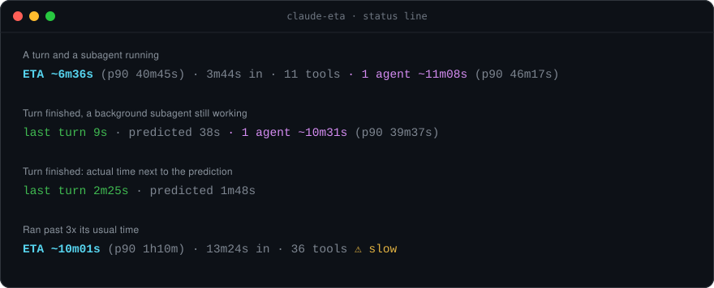
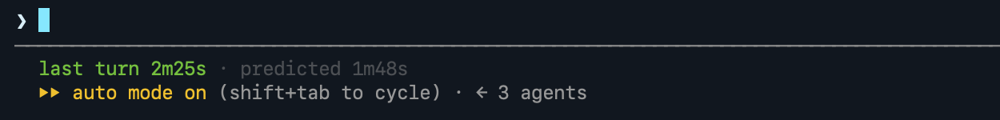

# claude-eta

**How long will this Claude Code turn take?** claude-eta answers in your status line, for the turn
and for any subagents it started. It learns from your own past sessions.

[](#how-it-works)
[](eta.py)
[](eta.py)
[](LICENSE)



<sub>Every line above is real output. The first two are replays of past sessions, the third is a
screenshot (below) and the fourth was captured live. Nothing was chosen to make the predictions look
good.</sub>



## What you see

| Segment | Meaning |
|---|---|
| `ETA ~6m36s` | Likely time left in this turn (median of similar past turns) |
| `(p90 40m45s)` | "Done within": 9 times in 10 the turn ends before this |
| `3m44s in · 11 tools` | Time and tool calls so far |
| `1 agent ~11m08s (p90 46m17s)` | Subagents still running, and time until the last one finishes |
| `last turn 2m25s · predicted 1m48s` | When a turn ends: actual time next to the prediction |
| `⚠ slow` | The turn has run 3x its usual time |

## Install

```sh
mkdir -p ~/.claude/eta
curl -fsSL https://raw.githubusercontent.com/harshece16/claude-eta/main/eta.py -o ~/.claude/eta/eta.py
```

Then add this to `~/.claude/settings.json`:

```json
"statusLine": { "type": "command", "command": "python3 ~/.claude/eta/eta.py", "refreshInterval": 5 }
```

`refreshInterval` makes the line tick during long tool calls. Older Claude Code versions ignore it and
update on each message. The first render shows `ETA: learning from your past sessions…` while it scans
`~/.claude/projects` in the background, which took 20–30 s for 4,000 turns. It rescans once a day.

### With ccstatusline or your own status line

eta.py reads the same JSON on stdin as any status line command. In
[ccstatusline](https://github.com/sirmalloc/ccstatusline), add a **Custom Command** widget with
`python3 ~/.claude/eta/eta.py`. In your own script, chain it:

```sh
#!/bin/sh
input=$(cat)
echo "$(echo "$input" | your-statusline) · $(echo "$input" | python3 ~/.claude/eta/eta.py)"
```

Set `NO_COLOR=1` for plain text.

## How it works

Your transcripts already record when every prompt was sent, every tool call, and when each turn and
subagent finished. eta.py turns that into a table of past runs, then:

- **At the prompt:** it takes the median and 90th percentile of past turns that began with the same
  first word (`fix`, `commit`, `/review`, …) and were of similar length. With fewer than 20 matches it
  falls back to length alone, then to all turns.
- **While the turn runs:** it uses only past turns that already lasted this long and made at least this
  many tool calls, and reports their remaining time. The longer a turn runs, the more likely it is a
  long one, so the ETA can grow.
- **This session's pace:** it pulls the median toward the geometric mean of the session's last 3 turns.
  The pull fades as the turn outlasts that pace.
- **Subagents:** it finds this session's running subagents and predicts each one the same way, from
  past runs of the same agent type (`Explore`, `general-purpose`, your own agents).

## Accuracy

Check it on your own history:

```sh
python3 ~/.claude/eta/eta.py train
```

This trains on your oldest 80% of runs and tests on the newest 20%. The author's 3,496 turns and 752
subagent runs:

| Point in the run | Median within 2x of actual | Actual under p90 | Typical error |
|---|---|---|---|
| Turn: prompt sent | 41% | 91% | 2m19s |
| Turn: 30 s in | 42% | 92% | 3m57s |
| Turn: 2 min in | 42% | 93% | 5m08s |
| Subagent: launched | 37% | 98% | 8m09s |
| Subagent: 2 min in | 51% | 97% | 4m14s |

**The p90 is the number to trust.** "Done within X" holds 9 times in 10, so you know when it is safe to
walk away. The median is weaker: it lands within 2x about 4 times in 10, because run times are
heavy-tailed. Here a tenth of turns end in under 8 s and a tenth run past 19 min. The subagent rows
come from about 50 test runs, so read them as rough.

Each of these was tested and moved accuracy by 1 point or less, so none is used: project folder, model,
entrypoint (CLI vs SDK) and permission mode. Session pace added 4 points at the prompt.

## Privacy

eta.py reads local files only and makes no network calls. It writes `eta-turns.json` next to itself. For
each run that file holds the start time, the duration, the tool count, the prompt's first word (or the
subagent type) and a length bucket. Nothing else from your prompts is stored.

## Limits

- It reads the last 4 MB of a transcript, so a very long turn can lose its start.
- It treats runs over 2 h as noise, such as a session left open overnight.
- A subagent silent for 30 min is treated as finished, which includes one waiting on a very long tool
  call.
- It needs Python 3.8+ and has been tested on macOS. It should work on Linux.

## Test

```sh
python3 test_eta.py
```

## License

MIT
